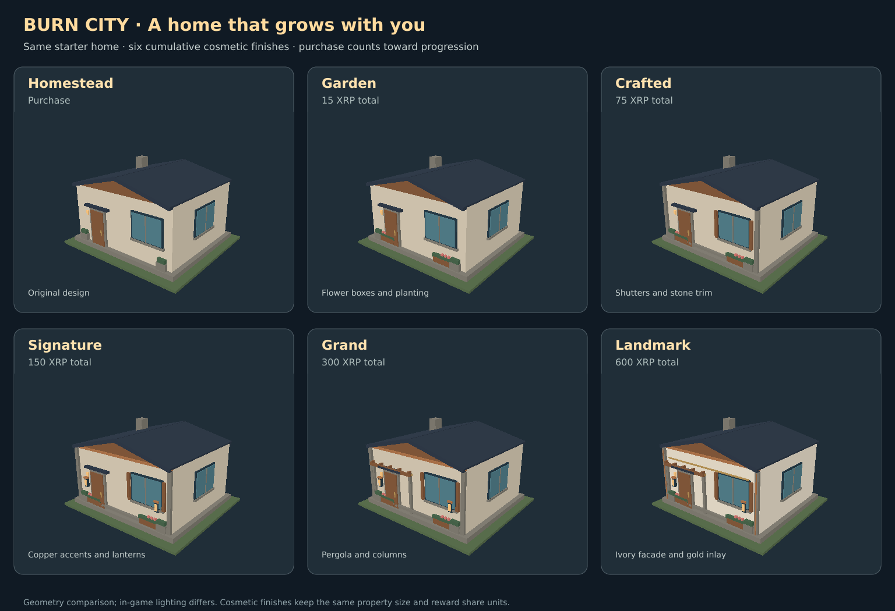

# Property appearance progression

A property's verified purchase and subsequent verified cosmetic payments build its visible finish. Its original tier still determines building size and reward share units. Cosmetics do not change ownership, access rights, reward weights or earnings.

| Stage | Total XRP invested | Added appearance |
| --- | ---: | --- |
| Homestead | 0 | Original architectural design |
| Garden | 15 | Flower boxes and layered planting |
| Crafted | 75 | Shutters and stone facade trim |
| Signature | 150 | Copper details and warm entry lanterns |
| Grand | 300 | Timber pergola and decorative columns |
| Landmark | 600 | Ivory facade, gold inlay and rooftop crest |

These are initial cosmetic design thresholds, not changes to property prices. For example, a verified 3 XRP trailer purchase counts toward Garden; the next-stage quote is 12 XRP. A 300 XRP mansion purchase starts at Grand. All later cosmetic stages accumulate on the existing building, rather than changing its collision shell or floor area.

The comparison is a software projection of the actual model geometry; in-game lighting differs.

## Player experience

Walk up to a home and select **View home & upgrades**. Guests can preview its purchase appearance; signed-in owners see verified spending, the next stage's exact price, and reversible next-stage previews. Preview buttons perform no signing or financial request and never persist a stage. Closing/changing the panel restores the verified appearance. Current stages are fetched from the server on island entry and at most every 30 seconds while exploring. Identical states skip geometry rebuilding. The entire neighbourhood uses at most thirteen instanced material batches for architecture at all stages; no additional dynamic lights or frame animation are added.

## Payment boundary

`ESTATE_COSMETIC_UPGRADES_ENABLED=1` is a separate opt-in, requiring mainnet, non-dry-run configuration, existing Xaman credentials and treasury, and an unpaused treasury. It remains unset/disabled in this change. Property sales and hourly distributions are not enabled here.

Authenticated `/api/estates/upgrade/quote`, `/start` and `/confirm` bind each request to the session wallet. Price, next level and original spend come from SQLite and server policy, never the browser. Only the server's bound Xaman payload supplies a transaction hash. Exact validated XRPL sender, treasury destination, amount, delivered XRP, memo, hash, successful result and original quote window are checked before an atomic cosmetic credit. The memo namespace `burncity/estates/cosmetic` is separate from property purchase receipts. Used transaction hashes are unique. Original purchase transactions cannot be credited again. Cosmetic credits do not feed reward accounting.

The original payment verifier's default property-sale namespace is unchanged. Cosmetic reconciliation uses its existing expired-review checks to prove that a late-discovered payment happened inside the original ten-minute window; only the cosmetic store is then credited. Reconciliation remains possible while paused, but no new signing requests are issued. A changed property owner or changed spend prevents settlement. Pending signing requests survive a process restart. Ambiguous remote creation stays held rather than issuing another payment; operator review is required before retrying a held/expired creation. There is no automatic cancellation or refund.

Public `/api/estates/appearance` returns aggregate per-property appearance, spending and public thresholds. It does not expose owner wallets, payment hashes, Xaman UUIDs or pending upgrade records.

## Verification

- Real vendored Three.js geometry: all stages and all properties fit the existing collision footprints; every stage adds visible detail; material batching, rebuild skipping and resource release are checked.
- Runtime and real HTTP tests: owner/session enforcement, disabled gates, exact quoting, tampered payments, duplicate-hash prevention, pause and late/restart recovery, unchanged reward shares, public data privacy and ambiguous payload holds.
- UI tests: guest previews, no-payment preview controls, disabled payment controls, server-bound session confirmation and pending validation.
- Local `npm test` and `npm run test:all` passed. Browser WebGL inspection was unavailable in the provided environment during the previous visual pass; real iPhone/desktop appearance and frame rate remain to be checked. `client/estates-visual-review.html` includes a finish selector for visual review.
