# Estates Tycoon upgrade visuals: before / after

Rendered locally with headless Chromium (SwiftShader WebGL) using the real
`estates-house-design`, `estates-tycoon-decor` and `estates-helicopter-world`
modules, all 17 exterior upgrades plus the helicopter installed on each tier.
Night shots use the same scene with ambient/sun lowered.

All geometry is procedural Three.js primitives written for this repo; no
third-party models, textures or animations are used.

| View | Before | After |
|---|---|---|
| Starter, front | 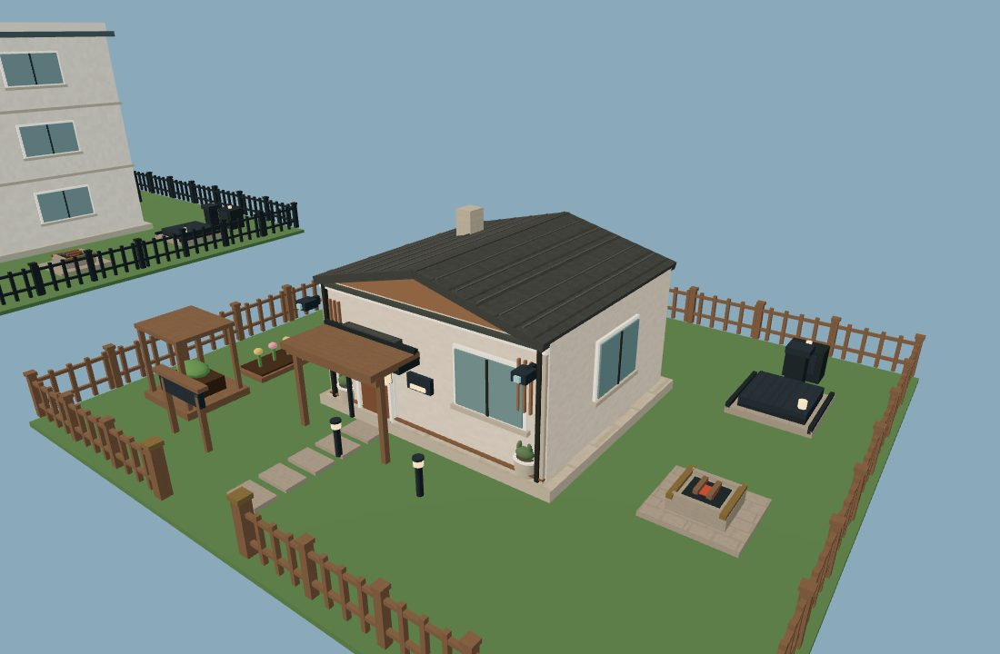 |  |
| Family, rear | 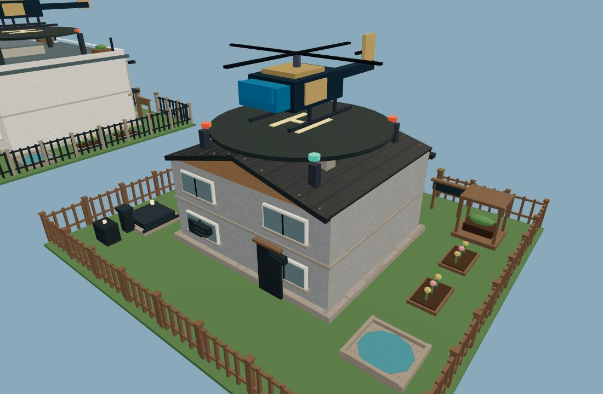 | 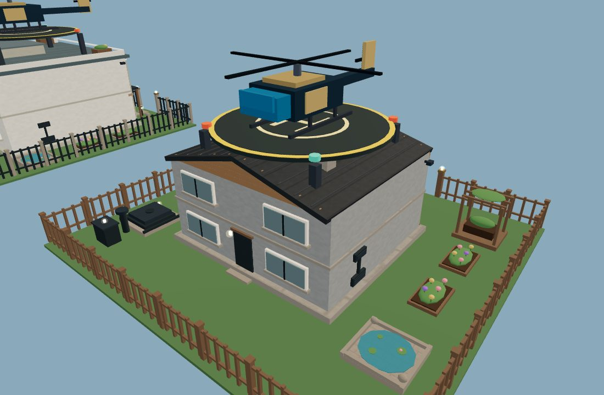 |
| Mansion, front | 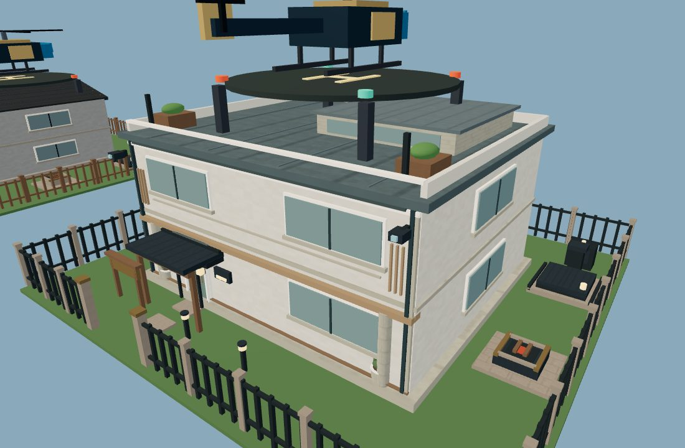 | 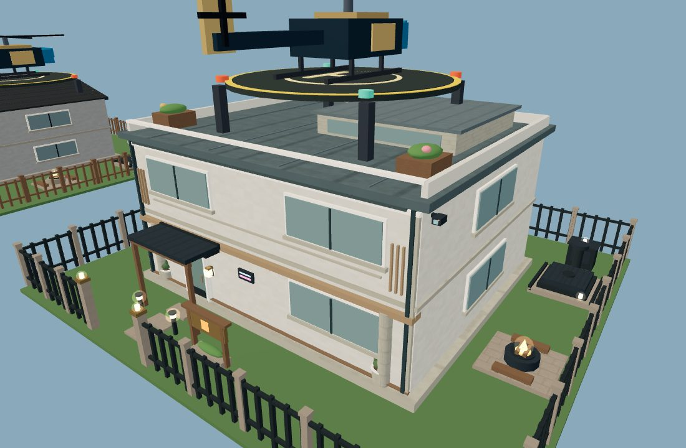 |
| Trailer, front | 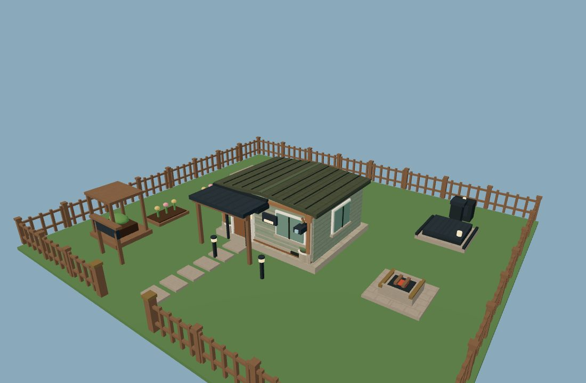 | 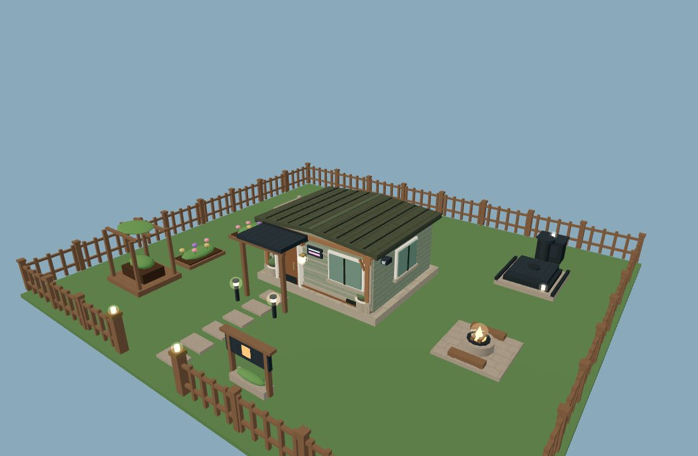 |
| Starter, night | 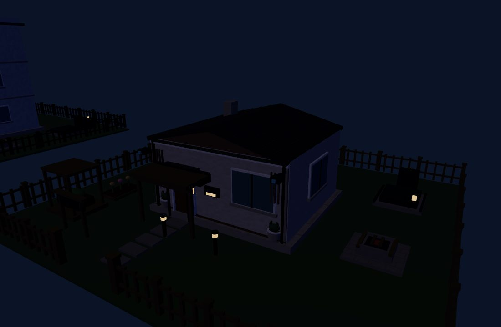 | 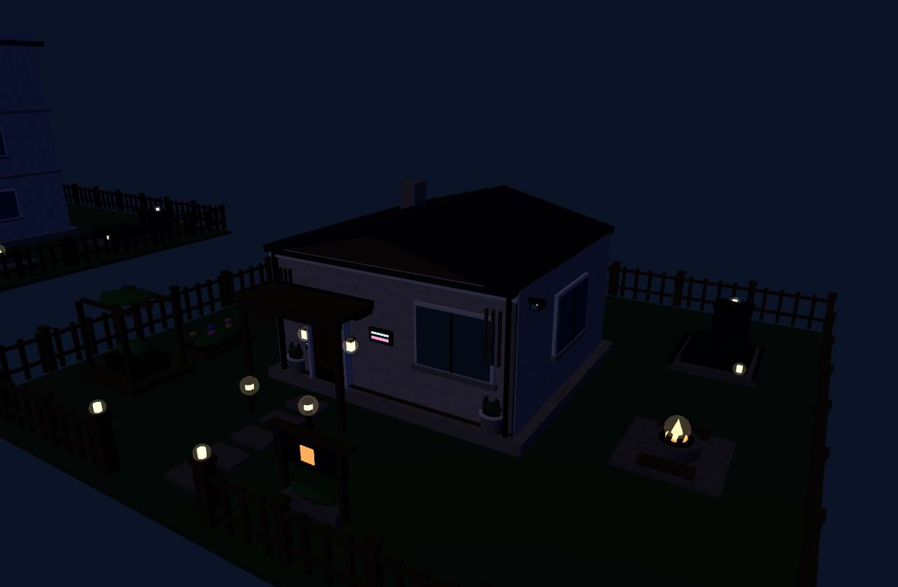 |
| Family, night | 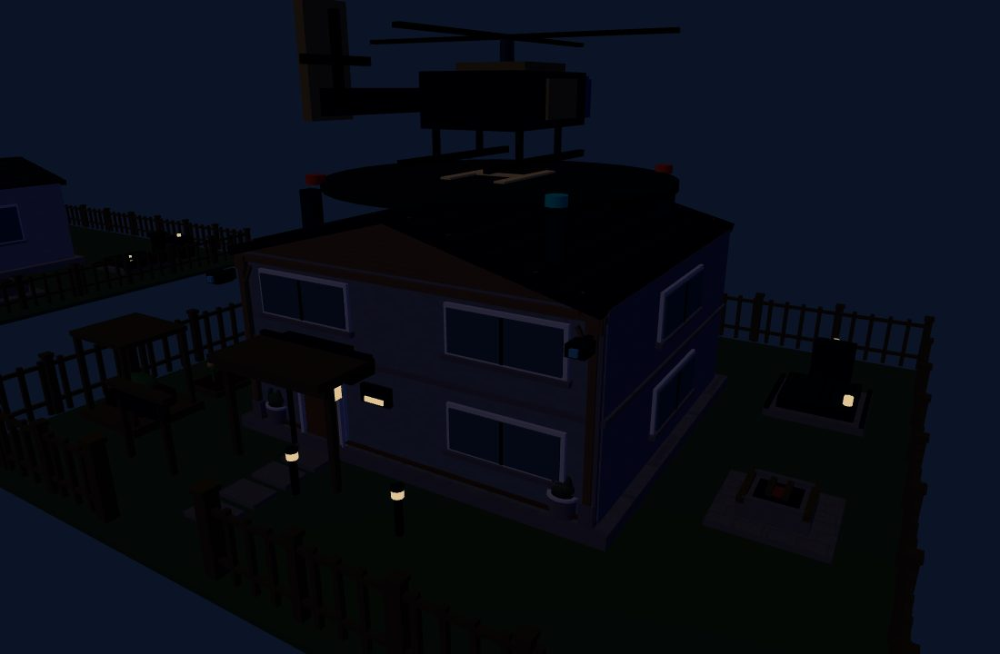 | 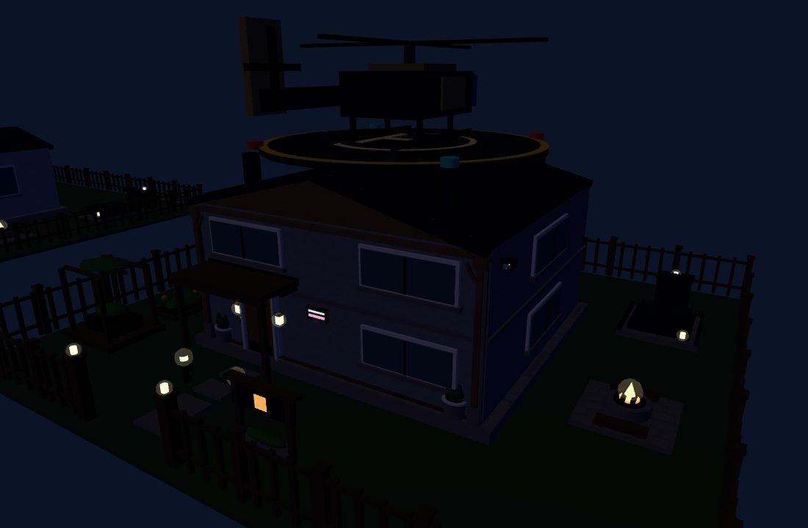 |

Install animation (mid-frame, ~0.4 s after a verified purchase lands):
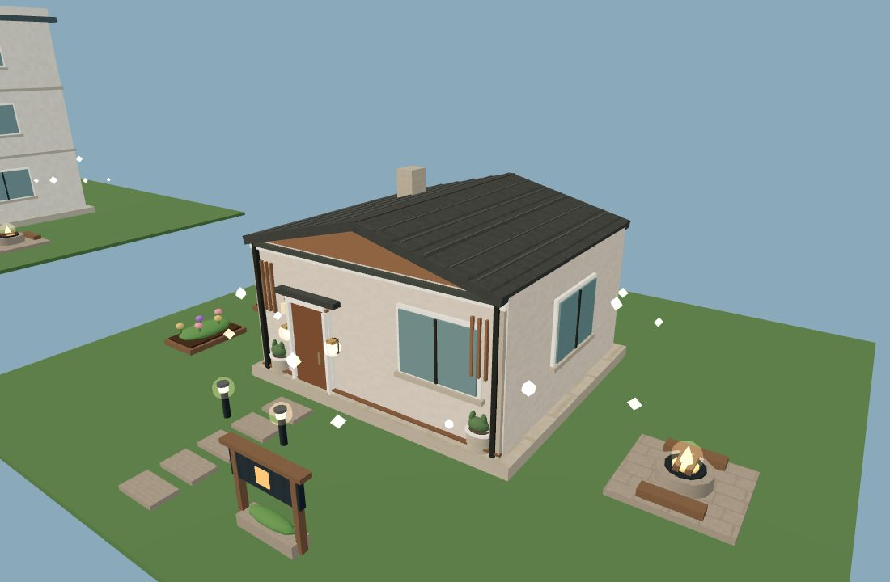
